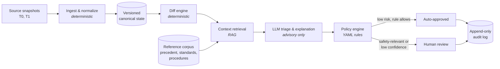

# Agentic Aviation Data Change Monitor

**Detect, explain, and govern changes in airport infrastructure data — in regulated environments where proprietary data cannot leave the network.**

> **About this repository.** This is a public *design abstract* of a prototype built in late 2025. The reference implementation, client-specific configuration, and all proprietary data remain private. Everything shown here uses synthetic data. This system is **not** certified for operational or navigational use.

---

## The problem

Airport infrastructure data — runways, taxiways, gates, lighting, construction closures — changes constantly and arrives from many sources in inconsistent formats. Every change has to be detected, understood, assessed for operational impact, and approved by the right person, with a record of who decided what and why.

Today this is largely manual review. It is slow, inconsistent across reviewers, and hard to audit. Generic AI tooling doesn't fit either:

- **The data is proprietary and often contractually or legally restricted** from being sent to external AI providers.
- **The domain is safety-relevant.** An AI system cannot be the authority on whether a runway changed.
- **Auditors need determinism.** "The model said so" is not an acceptable record.

## Design principles

1. **Deterministic code is the source of truth.** Ingestion, normalization, versioning, and change detection are plain code. Every change is detected by a diff, not by a model, so the LLM cannot cause a change to be missed.
2. **The LLM is advisory only.** It explains changes in plain language, retrieves relevant context, and proposes an impact category. It never approves, rejects, or writes to downstream systems.
3. **Policy as code.** Approval rules live in version-controlled YAML that a non-engineer can read and an auditor can review.
4. **Human-in-the-loop by default.** Anything safety-relevant or low-confidence goes to a named human reviewer. Auto-approval is opt-in, per change type.
5. **Zero data egress is supported.** The system runs end-to-end on local open-weight models with no external API calls.
6. **Model-agnostic.** Models sit behind a single provider interface, so the deployment can move between local, private-cloud, and hosted models without changing the pipeline.

## Architecture



Orchestration uses **LangGraph** with a shared, typed state object passed between stages.

### Where AI is and isn't used

| Stage | Implementation | Uses an LLM? | Why |
|---|---|---|---|
| Ingest & normalize | Python, schema validation | No | Must be repeatable and testable |
| Versioning | Content-hashed snapshots | No | Audit requires exact reproducibility |
| Change detection | Structural + semantic diff | No | A missed change is a safety issue; this must be deterministic |
| Context retrieval | RAG over a local vector index | Embeddings only | Finds prior decisions on the same airport, applicable standards, and internal procedures |
| Explanation & triage | LLM | **Yes** | Plain-language summary, proposed impact level, cited context |
| Approval decision | Policy engine + human | No | Decisions must trace to a rule or a named person |
| Audit trail | Append-only, hash-chained log | No | Tamper-evident record for reviewers and auditors |

## Deployment modes

The same pipeline supports three deployment modes. Data classification determines which applies.

| Mode | Where models run | Fits | Trade-offs |
|---|---|---|---|
| **A — Air-gapped local** | Open-weight models on on-prem or in-enclave GPUs | Hard no-egress requirements; export-controlled or contract-restricted data | Full control and zero egress; smaller models; the team owns hardware, patching, and model updates |
| **B — In-tenancy private cloud** | Frontier models via a private endpoint inside the organization's own cloud tenancy (e.g., a government or sovereign region) | Legal has approved in-tenancy processing with no training on customer data | Stronger reasoning and less to operate; requires legal sign-off and a residency and access review |
| **C — Hybrid** | Local models for restricted data; private-cloud models for redacted or synthetic data | Mixed-sensitivity portfolios | Best capability per data class; requires classification-driven routing |

A **mock provider** is the default for demos and tests, so the full pipeline runs with no model at all.

### Inference serving

| Stage | Serving | Rationale |
|---|---|---|
| Prototype / developer laptop | Ollama | Fast setup, easy model swapping |
| Pilot and beyond | vLLM, TGI, or NVIDIA NIM | Batching, concurrency, pinned model versions, metrics |

### Provider configuration (illustrative)

```yaml
llm:
  provider: local            # mock | local | private_cloud
  endpoint: http://inference.internal:8000/v1   # OpenAI-compatible API
  model: <pinned-model-name>@<weights-sha256>
  temperature: 0.0
  max_tokens: 800

embeddings:
  provider: local
  model: <pinned-embedding-model>

routing:
  # data classification -> allowed providers
  restricted:   [local]
  internal:     [local, private_cloud]
  synthetic:    [mock, local, private_cloud]
```

## Approval policy (policy as code)

```yaml
# policies/approval_rules.yaml (illustrative)

always_require_review:
  - change_type: "Runway Modification"
  - change_type: "Runway Closure"
  - change_type: "Taxiway Geometry"
  - change_type: "Lighting / NAVAID"

auto_approve:
  - change_type: "Gate Reassignment"
    max_impact: LOW
    min_calibrated_confidence: 0.95

require_review_if:
  calibrated_confidence_below: 0.85
  source_conflict: true        # sources disagree about the same feature
  first_seen_feature: true     # feature has no prior history

reviewers:
  safety_relevant: [airside_ops_lead]
  default: [data_steward]
```

Rules are versioned with the code, and every decision in the audit log records which rule version applied.

## Confidence and evaluation

Confidence thresholds only mean something if they are measured. The system does **not** rely on an LLM's self-reported confidence.

- **Golden dataset.** Historical snapshot pairs where the true changes and correct impact classifications are known and reviewed by domain experts.
- **Calibrated confidence.** The triage score is calibrated against the golden set, so "0.85" corresponds to an observed accuracy rate.
- **Metrics, per change type:**
  - Detection recall (expected to be 100%, since detection is deterministic; tested as a regression guard)
  - Triage accuracy: was the impact level correct?
  - **Critical under-triage rate:** a safety-relevant change labeled low impact. This is the metric that matters most.
  - Reviewer time per data cycle, compared with the manual baseline
- **Regression gate.** Any change to the model, prompt, retrieval corpus, or policy re-runs the evaluation suite before release.

## Security and compliance posture

| Concern | Approach |
|---|---|
| Data egress | Mode A makes no external network calls; egress is blocked at the network layer, not just in config |
| Model provenance | Weights pinned by hash; an AI bill of materials records model, license, and source |
| Prompt injection | Free-text fields (remarks, notices) are treated as untrusted; the LLM has no tools, no write access, and no ability to trigger actions |
| Access control | Role-based reviewer permissions; separation between rule authors and approvers |
| Auditability | Append-only, hash-chained log of inputs, model version, retrieved context, rule version, decision, and decider |
| Change control | Model, prompt, and policy updates follow the same review and release process as code |
| Aeronautical data assurance | The LLM is intentionally kept **outside the integrity-critical path**. Detection and the authoritative record are deterministic. Any operational use would need assessment under applicable data-process assurance guidance (e.g., RTCA DO-200B, FAA AC 20-153B) |

## Status and roadmap

| Phase | Scope | Status |
|---|---|---|
| **0. Prototype** | Deterministic ingest, versioning, and diff; LangGraph orchestration; YAML policy engine; notebook-based human review; mock and hosted providers; local open-weight models with RAG | ✅ Completed (late 2025) |
| **1. Pilot readiness** | One real data stream (e.g., FAA NASR 28-day cycle data for a defined set of airports); golden dataset and evaluation harness; production inference server; data-flow diagram, threat model, and model card for compliance review | 🗺️ Planned |
| **2. Shadow pilot** | Run in parallel with the existing manual process for 2–3 data cycles; compare reviewer time and triage accuracy; no operational reliance | 🗺️ Planned |
| **3. Limited production (assistive)** | Review web app (FastAPI) with role-based access and sign-off; monitoring and drift detection; model change control; humans remain the approvers | 🗺️ Planned |
| **4. Scale** | Additional airports and sources; notifications to downstream systems; Mode B or C where approved | 🗺️ Planned |

### Pilot success criteria (proposed)

- Zero critical under-triage on the golden set and during the shadow pilot
- At least a 50% reduction in reviewer time per cycle against the manual baseline
- Every decision reproducible from the audit log
- Compliance review passed for the chosen deployment mode

## Reference implementation layout (private)

```
agentic-aviation-change-monitor/
├── agents/
│   ├── ingestion_agent.py         # deterministic ingest, normalize, version
│   ├── change_analysis_agent.py   # diff + RAG context + LLM explanation
│   └── policy_review_agent.py     # rule evaluation, routing, audit
├── providers/                     # mock | local | private_cloud
├── retrieval/                     # local vector index over reference corpus
├── workflow/agentic_pipeline.py   # LangGraph graph definition
├── schemas/                       # canonical airport state, change events
├── policies/approval_rules.yaml
├── eval/                          # golden sets, metrics, calibration
├── data/synthetic_*.json
└── notebooks/demo_review.ipynb    # prototype review interface
```

## Tech stack

Python · LangGraph · Pydantic schemas · YAML policy engine · local vector store for RAG · OpenAI-compatible model interface (Ollama for development; vLLM, TGI, or NIM for pilot) · Jupyter (prototype review) → FastAPI (planned review app)

## Disclaimer

All data in this repository is synthetic. This is a design abstract of a prototype, not an operational system. It has not been certified or approved for navigational, operational, or safety-of-flight use.

## Author

Bilal Khan — [LinkedIn](https://www.linkedin.com/in/bilalakhan/)

The prototype was built by a small engineering team under my technical direction.
